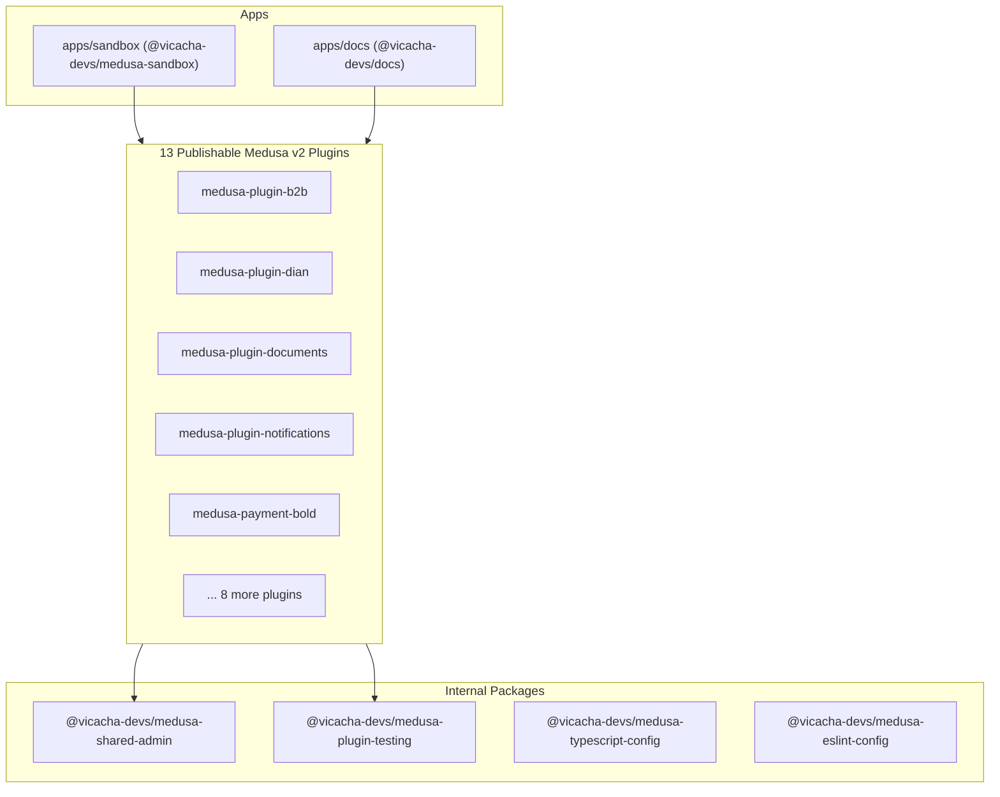

`@vicacha-devs/medusa-v2-extensions` is a **pnpm + Turborepo + Changesets** monorepo housing 13 publishable Medusa v2 plugins, shared internal libraries, a Medusa sandbox host (`apps/sandbox`), and this Starlight documentation site (`apps/docs`).

## Workspace Directories

- **`packages/<slug>/`**: Publishable Medusa v2 plugins following standard Medusa v2 conventions (`src/modules`, `src/workflows`, `src/api`, `src/subscribers`, `src/jobs`, `src/providers`, `src/admin`).
- **`packages/shared/`**: `@vicacha-devs/medusa-shared-admin` — reusable Admin UI components (data tables, filters, media galleries, RBAC guards) and hooks.
- **`packages/plugin-testing/`**: `@vicacha-devs/medusa-plugin-testing` — zero-install TypeScript resolver and offline test shims.
- **`apps/sandbox/`**: `@vicacha-devs/medusa-sandbox` — full Medusa v2 host wiring all plugins on `http://127.0.0.1:9001` with Playwright E2E specs.
- **`apps/docs/`**: `@vicacha-devs/docs` — Starlight + Pele diagrams + OpenAPI 3.1 reference.
