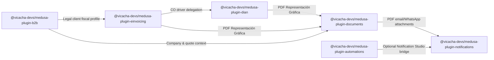

Plugins in this suite are designed to work standalone **and** compose seamlessly when installed together:

## Key Bridges

1. **E-Invoicing ↔ DIAN, B2B & Documents**:
   - `@vicacha-devs/medusa-plugin-einvoicing` provides the unified `FiscalDocument` ledger and routes `CO` (`co-dian`) submissions to `@vicacha-devs/medusa-plugin-dian` when installed (`dian` requires `einvoicing`).
   - Resolves B2B legal client tax IDs from `@vicacha-devs/medusa-plugin-b2b` and commercial PDF IDs from `@vicacha-devs/medusa-plugin-documents` with zero hard dependencies.
2. **Documents ↔ B2B & Notifications**:
   - Enriches invoices, quotes, and packing slips with B2B company tax IDs and billing metadata when `@vicacha-devs/medusa-plugin-b2b` is active.
   - Attaches generated PDF invoices and receipts to Email, WhatsApp, and Telegram dispatches in `@vicacha-devs/medusa-plugin-notifications`.
3. **Automations ↔ Notifications**:
   - `@vicacha-devs/medusa-plugin-automations` works standalone with `Modules.NOTIFICATION` and webhooks, and optionally bridges to `@vicacha-devs/medusa-plugin-notifications` via `mpn-notification-studio`.
4. **Shared Admin UI**:
   - Plugins consume `@vicacha-devs/medusa-shared-admin` for consistent DataTables, filter chips, media uploaders, and shared hooks.
