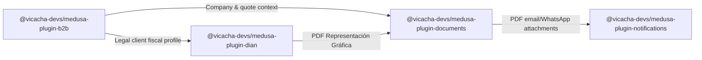

Plugins in this suite are designed to work standalone **and** compose seamlessly when installed together:

## Key Bridges

1. **DIAN ↔ B2B & Documents**:
   - Reads B2B legal client fiscal profiles from `@vicacha-devs/medusa-plugin-b2b` when issuing electronic invoices.
   - Delegates PDF *Representación Gráfica* rendering to `@vicacha-devs/medusa-plugin-documents`.
2. **Documents ↔ B2B & Notifications**:
   - Enriches invoices, quotes, and packing slips with B2B company tax IDs and billing metadata when `@vicacha-devs/medusa-plugin-b2b` is active.
   - Attaches generated PDF invoices and receipts to Email, WhatsApp, and Telegram dispatches in `@vicacha-devs/medusa-plugin-notifications`.
3. **Shared Admin UI**:
   - Plugins consume `@vicacha-devs/medusa-shared-admin` for consistent DataTables, filter chips, media uploaders, and shared hooks.
