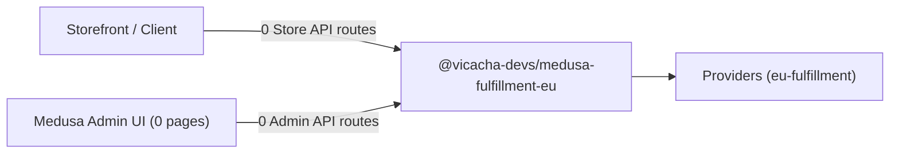

EU & Benelux fulfillment provider plugin for Medusa v2 supporting PostNL letterbox, Sendcloud EU parcel, and Rotterdam LCL pallet freight.

## Architecture Overview

## Medusa Modules & Data Models

| Module | Data Model                     |
| :----- | :----------------------------- |
| _None_ | _Provider / Route-only plugin_ |

## Key Capabilities & Integration Points

- **Package:** `@vicacha-devs/medusa-fulfillment-eu`
- **Workflows:** None
- **Event Subscribers:** None
- **Scheduled Jobs:** None
