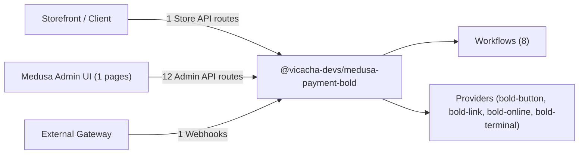

Bold Colombia 4-channel payment suite (Payment Button, Payment Links, Online API for Cards/PSE/Nequi/QR, and Smart POS Terminals) with loopback QA emulator.

## Architecture Overview

## Medusa Modules & Data Models

| Module | Data Model |
| :--- | :--- |
| _None_ | _Provider / Route-only plugin_ |

## Key Capabilities & Integration Points

- **Package:** `@vicacha-devs/medusa-payment-bold`
- **Workflows:** `create-bold-payment-link`, `create-bold-refund`, `get-bold-payment-methods`, `get-integration-api-payment-methods`, `get-payment-link-methods`, `get-terminals`, `create-bold-link`, `refund-bold-payment`
- **Event Subscribers:** None
- **Scheduled Jobs:** None
