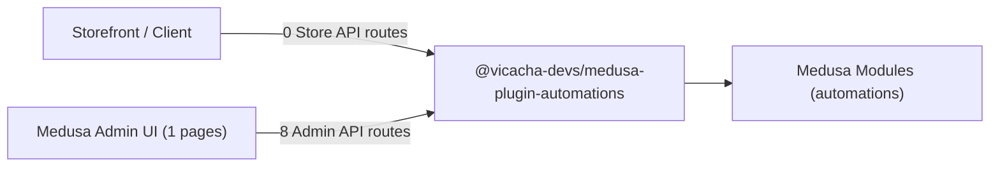

Rule-based trigger → condition → action automation engine for Medusa v2 with event/manual triggers, nested condition evaluation, and Notification & Webhook handlers.

## Architecture Overview

## Medusa Modules & Data Models

| Module        | Data Model                 |
| :------------ | :------------------------- |
| `automations` | `automation-execution-log` |
| `automations` | `automation-rule`          |

## Key Capabilities & Integration Points

- **Package:** `@vicacha-devs/medusa-plugin-automations`
- **Workflows:** None
- **Event Subscribers:** `automation-events`
- **Scheduled Jobs:** None
