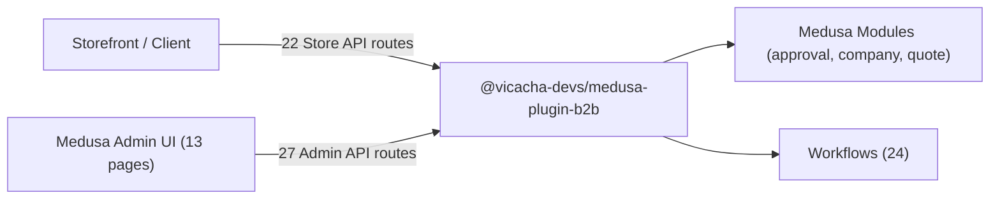

B2B companies, employee hierarchies, approval rules, spending limits, and quote negotiation workflows for Medusa v2.

## Architecture Overview

## Medusa Modules & Data Models

| Module     | Data Model          |
| :--------- | :------------------ |
| `approval` | `approval`          |
| `approval` | `approval-settings` |
| `approval` | `approval-status`   |
| `company`  | `company`           |
| `company`  | `employee`          |
| `quote`    | `message`           |
| `quote`    | `quote`             |

## Key Capabilities & Integration Points

- **Package:** `@vicacha-devs/medusa-plugin-b2b`
- **Workflows:** `create-approval-settings`, `create-approvals`, `update-approval-settings`, `update-approval`, `add-company-to-customer-group`, `create-companies`, `delete-companies`, `remove-company-from-customer-group`, `update-companies`, `create-employees`, `delete-employees`, `update-employees`, `cart-created`, `order-created`, `validate-add-to-cart`, `validate-cart-completion`, `validate-update-cart`, `update-order`, `create-quote-message`, `create-quote`, `create-request-for-quote`, `customer-accept-quote`, `customer-reject-quote`, `merchant-reject-quote`
- **Event Subscribers:** None
- **Scheduled Jobs:** `expire-quotes`
