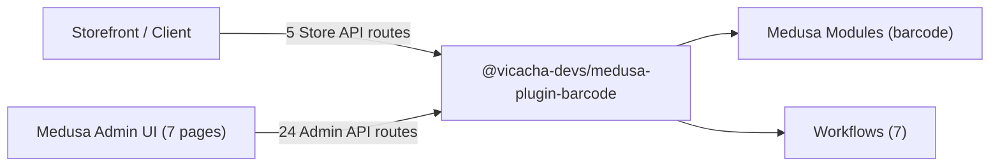

4-in-1 Barcode, GS1/QR generation, multi-provider GTIN lookup, thermal ZPL II & sheet label printing, anti-counterfeit verification, and warehouse stock-take.

## Architecture Overview

## Medusa Modules & Data Models

| Module | Data Model |
| :--- | :--- |
| `barcode` | _(service-only module)_ |

## Key Capabilities & Integration Points

- **Package:** `@vicacha-devs/medusa-plugin-barcode`
- **Workflows:** `apply-inventory-count`, `batch-barcode-import`, `bulk-generate-variant-barcodes`, `generate-barcode-tag`, `helpers`, `lookup-and-create-product`, `scan-inventory-count`
- **Event Subscribers:** `product-created`
- **Scheduled Jobs:** `purge-expired-barcode-cache`
