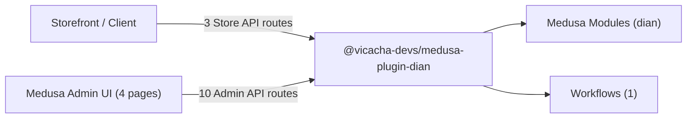

Colombian DIAN UBL 2.1 electronic invoicing (Resolución 000165), CUFE/CUDE SHA-384, XAdES-EPES signatures, SOAP Web Services, and pluggable providers.

## Architecture Overview

## Medusa Modules & Data Models

| Module | Data Model |
| :--- | :--- |
| `dian` | `dian-config` |
| `dian` | `dian-customer-fiscal-profile` |
| `dian` | `dian-electronic-document` |
| `dian` | `dian-resolution` |

## Key Capabilities & Integration Points

- **Package:** `@vicacha-devs/medusa-plugin-dian`
- **Workflows:** `emit-dian-document`
- **Event Subscribers:** `order-payment-captured`, `order-placed`, `order-refund-created`
- **Scheduled Jobs:** None
