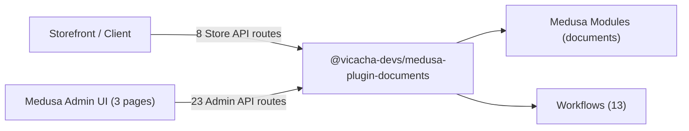

Invoices, packing slips, credit notes, and POS receipts with dual PDF engine (@react-pdf/renderer + Handlebars/pdfmake), 10-locale i18n, and Docuseal e-signatures.

## Architecture Overview

## Medusa Modules & Data Models

| Module      | Data Model          |
| :---------- | :------------------ |
| `documents` | `document`          |
| `documents` | `document-settings` |
| `documents` | `document-template` |
| `documents` | `signature-request` |

## Key Capabilities & Integration Points

- **Package:** `@vicacha-devs/medusa-plugin-documents`
- **Workflows:** `create-document-template`, `create-signature-request`, `delete-document-template`, `delete-document`, `delete-region-settings`, `generate-document`, `mark-documents-stale`, `regenerate-document-revision`, `allocate-and-render-document`, `fetch-order-context`, `update-document-template`, `update-signature-request`, `upsert-document-settings`
- **Event Subscribers:** `document-generated-email`, `fulfillment-created`, `order-canceled`, `order-placed`, `order-updated`, `refund-created`
- **Scheduled Jobs:** None
