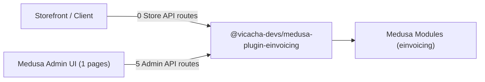

Country-agnostic electronic invoicing plugin for Medusa v2 with pluggable drivers (EU Peppol EN 16931, Colombia DIAN, Mexico CFDI 4.0, Generic UBL 2.1) and optional B2B & Documents bridges.

## Architecture Overview

## Medusa Modules & Data Models

| Module       | Data Model        |
| :----------- | :---------------- |
| `einvoicing` | `fiscal-config`   |
| `einvoicing` | `fiscal-document` |

## Key Capabilities & Integration Points

- **Package:** `@vicacha-devs/medusa-plugin-einvoicing`
- **Workflows:** None
- **Event Subscribers:** None
- **Scheduled Jobs:** None
