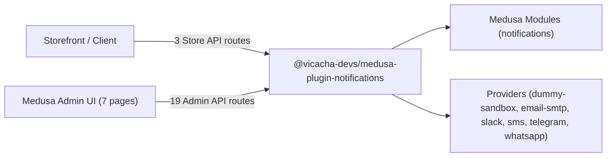

Multi-channel notification studio for Medusa v2: visual template builder, event mappings, consent ledger, abandoned cart recovery, broadcasts, and 6+ providers.

## Architecture Overview

## Medusa Modules & Data Models

| Module | Data Model |
| :--- | :--- |
| `notifications` | _(service-only module)_ |

## Key Capabilities & Integration Points

- **Package:** `@vicacha-devs/medusa-plugin-notifications`
- **Workflows:** None
- **Event Subscribers:** `customer-and-document-events`, `fulfillment-and-inventory-events`, `order-events`
- **Scheduled Jobs:** `abandoned-cart-recovery`, `log-retention-and-broadcasts`
