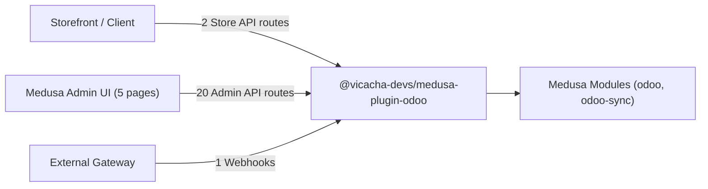

Bidirectional Odoo 14–19+ (JSON-RPC 2.0 & JSON-2) sync for products, multi-warehouse inventory drift reconciliation, orders, invoices, and offline POS replay.

## Architecture Overview

## Medusa Modules & Data Models

| Module | Data Model |
| :--- | :--- |
| `odoo` | _(service-only module)_ |
| `odoo-sync` | _(service-only module)_ |

## Key Capabilities & Integration Points

- **Package:** `@vicacha-devs/medusa-plugin-odoo`
- **Workflows:** None
- **Event Subscribers:** `customer-updated`, `inventory-updated`, `order-placed`, `product-updated`
- **Scheduled Jobs:** `odoo-reconciliation`, `odoo-scheduled-sync`
