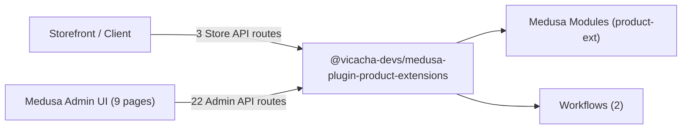

Rich video & 3D media, variant galleries, typed custom attributes with SI/Imperial normalization, hierarchical content sections, badges, swatches, and storefront overrides.

## Architecture Overview

## Medusa Modules & Data Models

| Module | Data Model |
| :--- | :--- |
| `product-ext` | _(service-only module)_ |

## Key Capabilities & Integration Points

- **Package:** `@vicacha-devs/medusa-plugin-product-extensions`
- **Workflows:** `upsert-product-ext`, `upsert-variant-ext`
- **Event Subscribers:** `product-created`, `product-deleted`
- **Scheduled Jobs:** None
