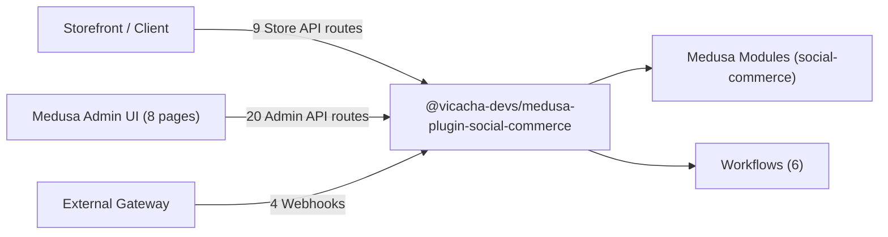

Multi-platform Social Commerce, live selling sessions, product tagging, and catalog sync for TikTok, Instagram, and Facebook / Meta Graph API.

## Architecture Overview

## Medusa Modules & Data Models

| Module | Data Model |
| :--- | :--- |
| `social-commerce` | `catalog-sync-item` |
| `social-commerce` | `live-product` |
| `social-commerce` | `live-session` |
| `social-commerce` | `social-account` |
| `social-commerce` | `social-media-post` |
| `social-commerce` | `social-product-tag` |

## Key Capabilities & Integration Points

- **Package:** `@vicacha-devs/medusa-plugin-social-commerce`
- **Workflows:** `account-connected.workflow`, `catalog-sync.workflow`, `checkout-handoff.workflow`, `live-ended.workflow`, `live-started.workflow`, `media-synced.workflow`
- **Event Subscribers:** `order-placed.subscriber`, `product-sync.subscriber`, `social-events.subscriber`
- **Scheduled Jobs:** `cleanup-reservations-and-sync-catalog.job`, `sync-social-media-and-tokens.job`
