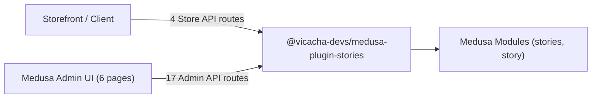

Shoppable 9:16 stories, highlight rings, X/Y product hotspots, interactive stickers (polls, countdowns, coupons), funnel analytics, and Storefront React UI Kit.

## Architecture Overview

## Medusa Modules & Data Models

| Module    | Data Model              |
| :-------- | :---------------------- |
| `stories` | _(service-only module)_ |
| `story`   | _(service-only module)_ |

## Key Capabilities & Integration Points

- **Package:** `@vicacha-devs/medusa-plugin-stories`
- **Workflows:** None
- **Event Subscribers:** `product-deleted`
- **Scheduled Jobs:** `expire-ephemeral-stories`
