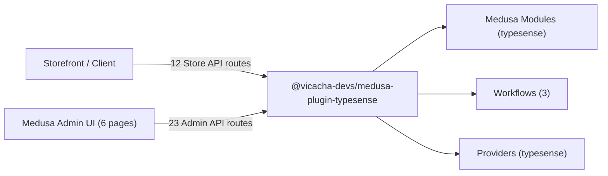

Typesense search indexing, vector/hybrid AI search, merchandising (synonyms, curations, stopwords), custom entity indexing, and InstantSearch storefront SDK.

## Architecture Overview

## Medusa Modules & Data Models

| Module | Data Model |
| :--- | :--- |
| `typesense` | `entity-config` |
| `typesense` | `search-analytics` |
| `typesense` | `sync-job` |

## Key Capabilities & Integration Points

- **Package:** `@vicacha-devs/medusa-plugin-typesense`
- **Workflows:** `delete-documents`, `sync-entities`, `upsert-documents`
- **Event Subscribers:** `category-sync`, `collection-sync`, `product-sync`
- **Scheduled Jobs:** `typesense-nightly-reconcile`
